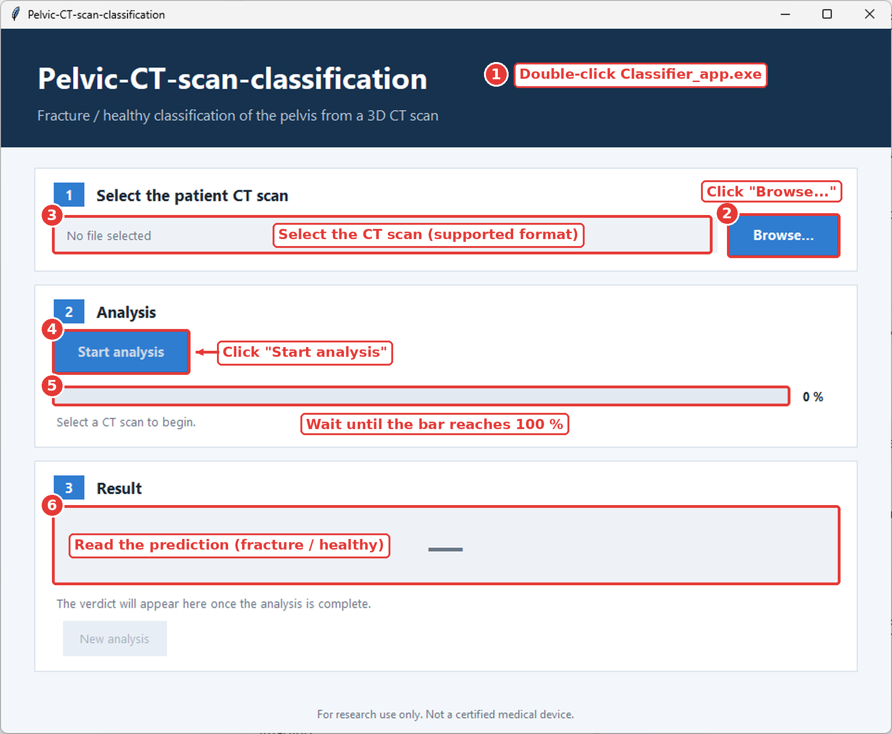

# Pelvic-CT-scan-classification
Image processing-based model for CT scan classification

This project aims to make our pelvic fracture classification model accessible for testing and research.

## Features

- **Automated classification:** classifies pelvic CT scans as fractured or healthy.
- **3D medical imaging:** designed for volumetric medical images.
- **NIfTI support:** accepts NIfTI files through the graphical interface, subject to the application's actual input requirements.
- **Graphical interface:** select a scan and launch the analysis without using a terminal.
- **Command-line interface:** launch the executable with command-line arguments.
- **Sample data:** includes 10 example cases to help users test the application.
- **Windows support:** currently designed to run on Windows.

## Getting Started

### Download the Application

You can download the repository using GitHub's **Code → Download ZIP** option, or clone it with Git and Git LFS:

```powershell
git lfs install
git clone https://github.com/ICARE86/Pelvic-CT-scan-classification.git
cd Pelvic-CT-scan-classification
git lfs pull
```

The repository contains large medical imaging files managed with [Git LFS](https://git-lfs.com/). Ensure the files have downloaded correctly before testing them.

## Running the Application

### Option 1: Graphical Interface
The graphical interface allows users to select a CT scan, launch the analysis, monitor its progress, and view the predicted classification.
Follow the instructions as shown below :



The application displays the classification result in its interface.

### Option 2: Command Line

The application can also be launched from Windows PowerShell or Command Prompt.

#### Usage

```text
Classifier_app.exe [-h] [--moving MOVING] [--output OUTPUT]
```

#### Arguments

| Argument | Description |
|---|---|
| `-h`, `--help` | Display the help message and available command-line options. |
| `--moving MOVING` | Specify the input image or volume to process. |
| `--output OUTPUT` | Specify the output path for the analysis results. |

#### Display the Help Message

Open PowerShell in the directory containing the executable and run:

```powershell
.\Classifier_app.exe --help
```

#### Example Command

```powershell
.\Classifier_app.exe --moving "C:\path\to\pelvic_scan.nii.gz" --output "C:\path\to\results"
```

Replace the example paths with the actual paths on your computer.

**Note:** The command-line arguments are shown according to the executable's usage signature. Confirm the accepted input formats and the expected meaning of `--output` using `--help` before running the analysis.

## Model Performance

The reported evaluation metrics are:

| Metric | Score |
|---|---:|
| Accuracy | 81% |
| Sensitivity | 82% |
| Specificity | 80% |

### What Do These Metrics Mean?

- **Accuracy (81%):** the proportion of all evaluated cases classified correctly.
- **Sensitivity (82%):** the proportion of fractured cases correctly identified as fractured.
- **Specificity (80%):** the proportion of healthy cases correctly identified as healthy.

Performance on new scans may vary depending on image quality, patient population, acquisition protocols, and dataset characteristics.

The sample cases included in this repository should not be assumed to represent the full evaluation dataset.

## Sample Dataset

The `Samples/` directory contains 10 example cases for testing the application.

| Category | Number of cases | Source |
|---|---:|---|
| Fractured | 5 | PENGWIN dataset, reported as open source |
| Healthy | 5 | CT Colonography dataset, reported as open source |
| **Total** | **10** | |

### Directory Structure

```text
Samples/
├── Fractured Samples/
│   ├── 004.mha
│   ├── 010.mha
│   ├── 051.mha
│   ├── 055.mha
│   └── 060.mha
└── Healthy Samples/
    ├── 1.3.6.1.4.1.9328.50.4.0003.nii.gz
    ├── 1.3.6.1.4.1.9328.50.4.0013.nii.gz
    ├── 1.3.6.1.4.1.9328.50.4.0091.nii.gz
    ├── 1.3.6.1.4.1.9328.50.4.0121.nii.gz
    └── 1.3.6.1.4.1.9328.50.4.0425.nii.gz
```

The sample files are tracked using Git LFS because of their large size.

## Limitations and Disclaimer

**This application is intended for research and testing purposes only.**

- It is not a certified medical device.
- Its predictions may be incorrect.
- The output must not be used as the sole basis for diagnosis or treatment.
- 
The authors do not guarantee the accuracy of predictions on new or unseen data.

## Repository Structure

```text
Pelvic-CT-scan-classification/
├── Classifier_app.exe
├── README.md
├── interface.png
└── Samples/
    ├── Fractured Samples/
    └── Healthy Samples/
```

## Feedback and Contributions

If you test the application, feedback is welcome.

Please use GitHub Issues to report:

- Application errors or compatibility problems.
- Difficulties loading supported scans.
- Unexpected classification results.
- Suggestions for improving the interface or documentation.

Thank you for testing **Pelvic CT Scan Classification**!
